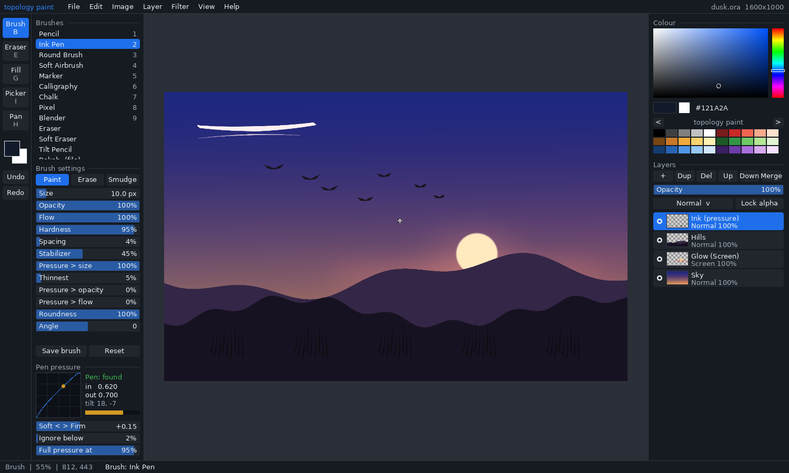
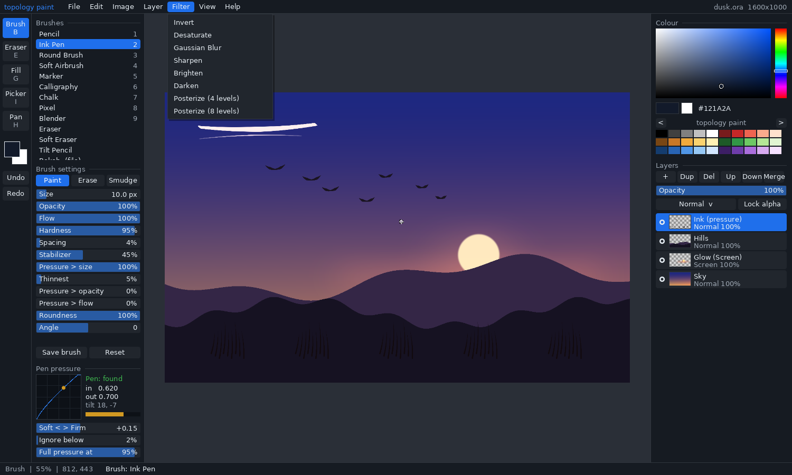
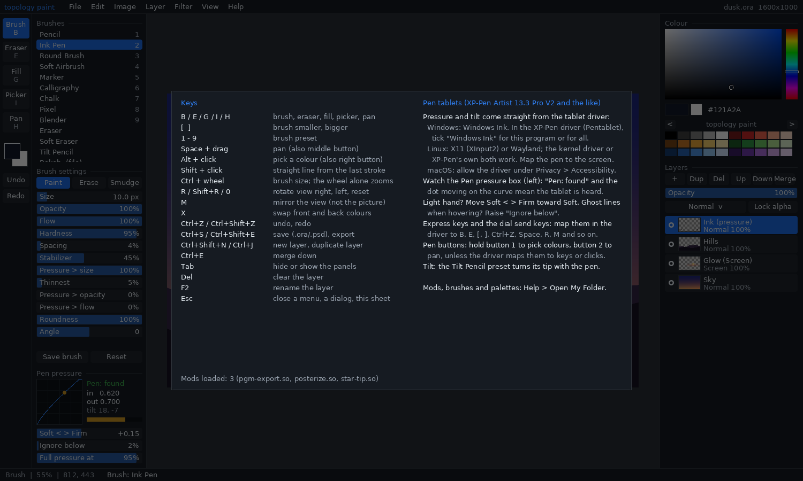

# topology paint

A drawing and painting program, built into topology. One C program for **Windows, Linux and macOS**,
made for Bryant Frankford: pressure-sensitive brushes, layers with blend modes, and the file formats
other painting programs use. It builds and installs with one file: `build.bat` on Windows,
`build.sh` elsewhere. You can extend it with brush files, palettes and mods (plug-ins written in C).



*The picture above is the program's own `--screenshot` mode. It paints a scripted scene with simulated
pen pressure: the tapered birds and grass are pressure strokes. The pen box shows the scene's
simulated pen values. This is how the README's pictures are made, and it doubles as a start-up
smoke test.*

## What it does

| | |
|---|---|
| **Pen tablets** | Pressure, tilt, the eraser end and the pen buttons, through SDL3's pen support: Windows Ink on Windows, XInput2 or Wayland tablet-v2 on Linux, the system tablet events on macOS. The pressure curve can be set softer or firmer, with a dead zone (*Ignore below*) and a full-pressure point (*Full pressure at*). A live meter shows what the tablet sends. Written with the XP-Pen Artist 13.3 Pro V2 in mind; see [Pen tablets](#pen-tablets). |
| **Brushes** | 12 built-in presets: Pencil, Ink Pen, Round Brush, Soft Airbrush, Marker, Calligraphy, Chalk, Pixel, Blender (smudge), Eraser, Soft Eraser and Tilt Pencil. Three more come as files (Charcoal, Bokeh, Star Stamp). Each brush has size, opacity, flow, hardness, spacing, a stabilizer, pressure-to-size/opacity/flow, roundness, angle (fixed or following pen tilt), size jitter and scatter. *Opacity* caps a whole stroke; *flow* builds up within it, as in Photoshop, Krita and Clip Studio. *Save brush* writes a `.brush` file you can share. |
| **Layers** | Up to 256 layers. Each has opacity, visibility, *Lock alpha* and one of 13 blend modes (Normal, Multiply, Screen, Overlay, Darken, Lighten, Add, Subtract, Difference, Color Dodge, Color Burn, Hard Light, Soft Light). New, duplicate, delete, move, merge down, rename. Thumbnails in the panel. |
| **Tools** | Brush, eraser, bucket fill (with tolerance; fills under anti-aliased line edges), colour picker, pan. Shift-click draws a straight line. Alt-click (or right-click) picks a colour. |
| **View** | Zoom at the cursor, rotate the view in 15° steps, mirror the view to check proportions, fit to window, actual pixels. Tab hides the panels. |
| **Editing** | Undo and redo (up to 400 steps or 1 GB), flip and rotate the picture, canvas size, copy the picture to the clipboard and paste a picture as a layer, drag a file onto the window. Built-in filters: Invert, Desaturate, Gaussian Blur, Sharpen, Brighten, Darken. Mods can add more. |
| **Safety** | An autosave copy every 3 minutes while there are unsaved changes (*File > Open Recovery* after a crash), and a Save / Discard / Cancel prompt before anything would lose work. |

### Files it reads and writes

| Format | Read | Write | Keeps layers |
|---|:-:|:-:|:-:|
| OpenRaster `.ora` (the native format; Krita, GIMP and MyPaint open it) | ✓ | ✓ | ✓ with opacity, visibility, blend mode, alpha lock |
| Photoshop `.psd` (8-bit RGB, PackBits compression) | ✓ | ✓ | ✓ with opacity, visibility, blend mode, alpha lock, Unicode names |
| PNG | ✓ | ✓ | |
| JPEG (quality 92; `jpeg_quality` in settings) | ✓ | ✓ | |
| TIFF (uncompressed or PackBits) | ✓ | ✓ | |
| BMP, TGA, QOI | ✓ | ✓ | |
| PPM | ✓ | ✓ | |
| GIF (first frame), Radiance HDR, PGM | ✓ | | |
| anything a mod adds (the example adds `.pgm` saving) | | | |

*File > Save* keeps layers (`.ora` or `.psd`). *File > Export* writes any format; a flat format
gets the picture flattened. Files are recognised by their content, not their name.



## Build, install, update

You need **CMake 3.16+** and **a C compiler**. The first build also needs internet access: it
downloads SDL 3.2.26 (about 15 MB) and checks it against a SHA-256 written in `CMakeLists.txt`. The
result is a single program with its `brushes`, `palettes` and `mods` folders beside it. The program
does not need SDL installed.

### Windows

Double-click **`build.bat`**, or run it in a command prompt:

```bat
build.bat            :: build into build\out\topology-paint.exe
build.bat install    :: build, install into %LOCALAPPDATA%\Programs\topology-paint, add Start menu and desktop shortcuts
build.bat update     :: git pull, then build and install again
build.bat run        :: build and start it
build.bat package    :: a .zip in dist\ to hand to someone
build.bat uninstall
```

It finds Visual Studio 2019/2022 (or the free *Build Tools* with "Desktop development with C++")
through `vswhere`, or MinGW-w64 `gcc` with Ninja. If it finds neither, it offers to install CMake
and the Build Tools with `winget`. Only system DLLs are needed (checked with `objdump`), so you can
copy `topology-paint.exe` to another PC on its own.

### Linux and macOS

```bash
./build.sh            # build into build/out/
./build.sh install    # Linux: ~/.local/opt/topology-paint, a link in ~/.local/bin, a menu entry
                      # macOS: ~/Applications/topology-paint.app
./build.sh update     # git pull, build, install again
./build.sh run | test | package | uninstall | clean
```

On Linux, SDL quietly leaves out any part whose headers are missing. `build.sh` checks for them and
tells you what each missing one costs. **Without `libxi-dev`, pen pressure does not work on X11.**
On Debian or Ubuntu, this installs everything:

```bash
sudo apt install build-essential cmake ninja-build git libx11-dev libxext-dev libxi-dev libxrandr-dev libxcursor-dev libxfixes-dev libxss-dev libwayland-dev libxkbcommon-dev wayland-protocols libegl-dev libdbus-1-dev
```

On macOS, run `xcode-select --install` and `brew install cmake`. The app is not notarized, so on the
first start, right-click it and choose *Open*.

### Where your things live

Settings (`settings.ini`), your own brushes, mods and palettes, and the autosave go in your user
folder. *Help > Open My Folder* opens it.

| | |
|---|---|
| Windows | `%APPDATA%\inputloop\topology-paint\` |
| Linux | `~/.local/share/inputloop/topology-paint/` |
| macOS | `~/Library/Application Support/inputloop/topology-paint/` |

Installing or updating never touches this folder.

## Pen tablets



**XP-Pen Artist 13.3 Pro V2 (and other XP-Pen, Huion and Wacom tablets):**

1. **Windows:** install XP-Pen's driver (*Pentablet*). In its settings, tick **Windows Ink**, either
   for all programs or for `topology-paint.exe`. topology paint reads the pen through Windows Ink;
   without it, you get a mouse with no pressure. Under *Monitor*, map the pen to the 13.3" display.
2. **Linux:** the kernel's `hid-uclogic` driver or XP-Pen's own driver both work. On X11, keep the pen
   on its screen with `xinput list` (find the *Pen* device) and `xinput map-to-output <id> <output>`.
3. **macOS:** install XP-Pen's driver and allow it under *System Settings > Privacy & Security >
   Accessibility*.
4. Start topology paint and touch the pen to the screen. The **Pen pressure** box (bottom left) says
   *Pen: found*, and the orange dot moves along the curve as you press.
5. Tune the feel:
   - **Soft < > Firm**: toward Soft if light strokes come out too thin, toward Firm if everything is
     heavy.
   - **Ignore below**: raise it if a resting or hovering pen leaves ghost marks.
   - **Full pressure at**: lower it if you never reach the full width.
   These settings are kept between sessions.
6. **Express keys and the dial** send keyboard shortcuts. Set them in the driver; good choices are:

   | Key | Does |
   |---|---|
   | `B` / `E` | brush / eraser (E toggles) |
   | `[` / `]` | smaller / bigger (put these on the dial) |
   | `Ctrl+Z` / `Ctrl+Shift+Z` | undo / redo |
   | `Space` (held) | pan |
   | `R` / `Shift+R` | rotate the view |
   | `M` | mirror the view |
   | `Alt` (held) | colour picker |
   | `Tab` | hide the panels |

7. **Pen buttons:** hold button 1 while touching down to pick a colour, or button 2 to pan, unless the
   driver maps those buttons to clicks or keys.
8. **Tilt:** the *Tilt Pencil* preset turns its flat tip with the pen's tilt. Any brush can do the
   same: set `tilt_angle = 1` in its file.

If strokes come out doubled or jagged, check that only one driver is installed.

## Keys

| | |
|---|---|
| `B` `E` `G` `I` `H` | brush, eraser, fill, picker, pan |
| `[` `]`, `Ctrl`+wheel | brush size |
| `1`–`9` | brush presets |
| `Space`+drag, middle button | pan |
| wheel, `+` `-`, `Ctrl+0`, `Ctrl+1` | zoom, fit, actual pixels |
| `R`, `Shift+R`, `0`, `M` | rotate the view, reset, mirror |
| `Alt`+click, right button | pick a colour |
| `Shift`+click | straight line from the last stroke |
| `X` | swap front and back colours |
| `Ctrl+Z`, `Ctrl+Shift+Z` / `Ctrl+Y` | undo, redo |
| `Ctrl+N` `Ctrl+O` `Ctrl+S` `Ctrl+Shift+S` | new, open, save, save as |
| `Ctrl+Shift+E`, `Ctrl+I` | export, import a picture as a layer |
| `Ctrl+C`, `Ctrl+V` | copy the picture, paste as a layer |
| `Ctrl+Shift+N`, `Ctrl+J`, `Ctrl+E` | new layer, duplicate, merge down |
| `Ctrl+]` `Ctrl+[`, `F2`, `/`, `Del` | move layer, rename, lock alpha, clear |
| `Tab`, `F1`, `Esc` | panels, help, close |

On macOS, `Cmd` works wherever `Ctrl` is listed.

## Mods

There are three levels, and each is described in **[docs/MODDING.md](docs/MODDING.md)**:

1. **Data, no compiler:** `.brush` files (plain `key = value` text) and GIMP `.gpl` palettes in
   `brushes/` and `palettes/`.
2. **Native mods:** a `.dll`, `.so` or `.dylib` in `mods/` that exports one function,
   `tpaint_mod_init`. Through it a mod can add **filters**, **file formats** and **brush tips**. The
   whole contract is one header, [`include/tpaint_mod.h`](include/tpaint_mod.h). Three examples are
   built with the program: `posterize` (filters), `pgm-export` (a format) and `star-tip` (a tip).
3. **The source:** the core (`src/core/`) has no window code. Adding a format, a blend mode or a
   tool is a few functions, and the guide shows where.

## How it is built

```
paint/
  build.bat, build.sh       one-command build / install / update
  CMakeLists.txt            fetches SDL 3.2.26 (sha256-pinned), static link
  include/tpaint_mod.h      the mod API, the only header a mod needs
  src/core/                 no SDL: documents, layers, compositing, undo (doc.c),
                            the brush engine (brush.c), every file format (formats.c),
                            filters, tips and the mod loader (mods.c)
  src/app/                  SDL3: the window, pen and keys (main.c), the panels (panels.c),
                            a small immediate-mode UI drawn in software (ui.c), the baked font
  mods/                     the three example mods
  brushes/, palettes/       data that ships beside the program
  tests/                    test_core.c (77 checks) and run.sh
  tools/mkfont.py           bakes DejaVu Sans into src/app/font_data.h
  docs/                     MODDING.md, LESSONS-LEARNED.md, screenshots
```

Layers store **premultiplied** RGBA8, so compositing, blur and smudge are exact. Files, mods and the
colour picker see straight (not premultiplied) RGBA. Duplicated layers and undo snapshots **share
pixel buffers until one is painted** (copy on write), so a layer-panel undo step costs almost no
memory.

## Tests

```bash
sh paint/tests/run.sh               # from the topology checkout; needs only a C compiler
sh paint/tests/run.sh --prove-red   # builds with planted faults; the tests must catch them
sh bin/test.sh                      # all of topology, this included
```

The 77 checks cover:

- compositing and blend modes;
- pressure (a firm stroke is wider; a taper thickens where pressed);
- opacity capping one stroke, flow building, the eraser, alpha lock;
- byte-exact undo and redo, and structural undo;
- fill and the colour picker;
- round trips for every format, including layer names, opacity, visibility, blend mode and alpha lock
  for `.ora` and `.psd`;
- brush and palette files;
- all three example mods;
- saving and opening in a folder named `Ünï 画`.

Two outside readers check what we write. **stb_image** reads the merged picture of our PSD, and
**Python's zipfile** reads our OpenRaster archive. A reader written by the same hand as the writer can
share its mistakes; these two cannot.

On Windows, the same test program runs as a real `.exe`: it was cross-built with MinGW and run under
Wine, with the mod DLLs loaded. GitHub Actions builds and tests it with MSVC on Windows, with clang on
macOS and with gcc on Linux (`.github/workflows/paint.yml`).

## Licence and credits

Made for Bryant Frankford, inside topology (Bryant Frankford, Corwin Brust and Contributors).
Code: GPL-3.0-or-later OR LGPL-3.0-or-later. Text: CC-BY-SA-4.0. It uses:

- [SDL 3](https://libsdl.org) (zlib licence), fetched at build time;
- [stb_image and stb_image_write](https://github.com/nothings/stb) by Sean Barrett (public domain or
  MIT), in `third_party/stb/`;
- glyphs from [DejaVu Sans](https://dejavu-fonts.github.io) (Bitstream Vera licence), baked into
  `src/app/font_data.h`; see `third_party/dejavu/LICENSE`.

What it does not do yet, and what was learned making it: **[docs/LESSONS-LEARNED.md](docs/LESSONS-LEARNED.md)**.
